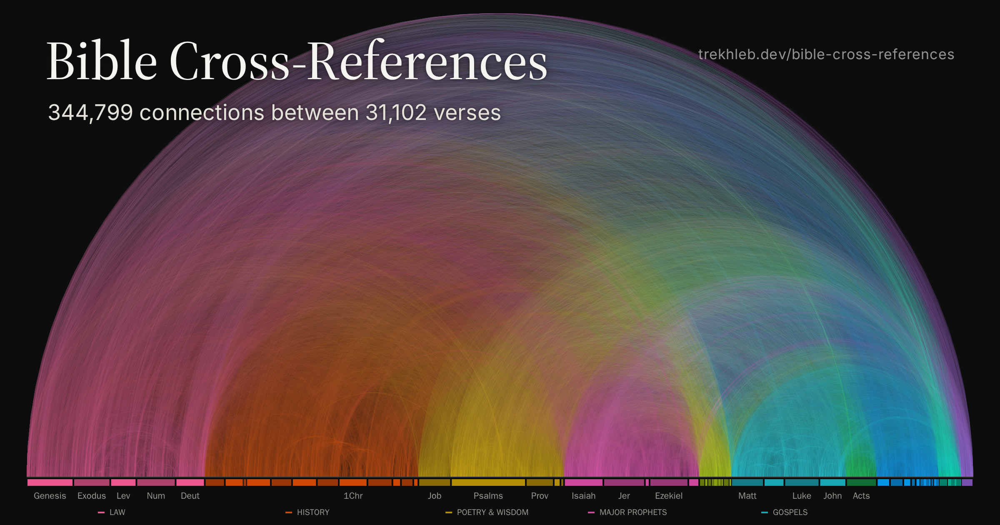

# Bible Cross-References

[](https://trekhleb.dev/bible-cross-references/)

See how the Bible is woven together, and read any passage with its connections in view.

**▶ [Open Bible Cross-References](https://trekhleb.dev/bible-cross-references/)**

## Why this exists

For centuries, readers of the Bible have followed cross-references: the small notes in the margin
that send you from one passage to another that echoes, quotes or fulfills it. The _Treasury of
Scripture Knowledge_ alone lists hundreds of thousands of them. On paper you can only follow them
one at a time, so the bigger picture stays hidden: how the prophets echo the Law, how the New
Testament quotes the Psalms and Isaiah, how far a single verse reaches.

This project draws all 344,799 of them at once. You can start from a bird's-eye view of the whole
Bible, zoom down to a single verse, and read it in context with every connection one click away.
It aims to be two things: a picture of how deeply the Bible is interconnected, and a practical
companion while reading.

It is free, open source, and built only on openly licensed data (see [Data](#data)).

## What you can do

### Arcs: the whole Bible at once


- All 31,102 verses sit on one line, from Genesis to Revelation, and every cross-reference is an
  arc colored by the genres it connects.
- Zoom from the whole Bible down to single verses; hover a passage to see how many connections it
  has.
- Search for any reference ("John 3:16", "Ps 23") or click a passage to see where its links land.
- Read it in six translations — English (Berean Standard Bible, King James Version), Portuguese,
  German, Italian and Spanish — with the interface in any of six languages: English, Portuguese,
  German, Italian, Spanish or Ukrainian; the choice is remembered and travels in the link you share
  ([`?t=kjv`](https://trekhleb.dev/bible-cross-references/?ref=John.3.16&t=kjv)).

### Focus a passage


The details panel shows the passage's text, where its connections go by genre, and every reference
with its text. Each one is a link: follow it to travel there. "Read in context" opens the passage in
Threads.

A verse also lists the Hebrew or Greek words behind it — the dictionary form, how it is said and
what it means — and, under each one, every other verse that uses the same word, least common
first. It is a different kind of link from a cross-reference and is kept apart from it: a
cross-reference is somebody's judgement that two passages belong together, while this is the plain
fact that they share a word. Acts 5:14 and Luke 5:6, for instance, share πλῆθος (_plēthos_,
"multitude"), which no cross-reference joins. Words used in more than 100 verses are left out, and
the text of the verse in its original language is never shown: only the dictionary form.

### Threads: read with the connections in view


- Read a chapter while each verse sends threads to where its cross-references land in the whole
  Bible, shown as a bar of all 66 books.
- Switch between what a verse points to, what points to it, or both.
- Tap a verse for its connections and follow them from passage to passage. "Show in Arcs" leads
  back to the big picture.

### On your phone


Both views work on phones. On the arcs, touch and hold, then slide, to preview passages (on the book
bar, just slide), and pinch to zoom. The details open in a sheet that you drag up to read and pull
down to close. Every passage has its own link, filters included, e.g.
[`?ref=John.3.16`](https://trekhleb.dev/bible-cross-references/?ref=John.3.16), so you can share
exactly what you are looking at.

### Install it, and read with no connection

Every footer carries a quiet **Install** link — an arrow alone on phones — which opens the steps
for the device you are reading on. The same guide opens at
[`#install`](https://trekhleb.dev/bible-cross-references/#install), so that address can be sent to
someone who asks for "the app". Inside the installed app the link is gone, since the browser tells
the page it is already running as one.

| Device          | How                                                                                                                                  |
| --------------- | ------------------------------------------------------------------------------------------------------------------------------------ |
| iPhone and iPad | Safari's share button, then _Add to Home Screen_. Other iOS browsers offer the same item where they support it (iOS 16.4 and later). |
| Android         | Chrome's menu, then _Install app_.                                                                                                   |
| Chrome, Edge    | The install button at the end of the address bar.                                                                                    |
| Safari on a Mac | _Share → Add to Dock_.                                                                                                               |

Open it once while you are online. The service worker ([`sw/`](sw/)) then keeps the pages, this
version's code and the datasets on the device, so the whole Bible, its 344,799 cross-references and
the text you are reading all work with no connection, and open instantly on the next visit. On an
iPhone or iPad that first visit has to happen inside the installed app: a home-screen app there has
storage of its own, apart from Safari's. On Android and the desktop the two share it, so the visit
that installed the app has already done the work.

## Languages

The app speaks English, Portuguese, German, Italian, Spanish and Ukrainian. Each has pages of its
own: English at the root,
every other language one path segment down
([`/pt/`](https://trekhleb.dev/bible-cross-references/pt/?t=blivre)). Which language a visit
speaks is settled in this order: the page's own path, then the address (`?lang=pt`), then the
reader's last choice, then what their browser asks for, then English. On a first visit the Bible
follows the interface — a browser asking for Portuguese arrives at the Bíblia Livre without being
asked — and after that the two are independent, so a Portuguese interface can read an English
text, or the other way round. Both are chosen in one menu, because the header has no room for a
sixth button.

The app speaks one language it cannot yet read: there are Ukrainian menus and no Ukrainian Bible,
because no complete one has been found that is both freely licensed and numbered the way this app
addresses verses. The two do not wait on each other, which is deliberate: a text can be adopted in
an afternoon once its licence and its verse numbering check out, while an interface is a few
hundred strings that want a native reader, and holding the Bibles back until the menus caught up
would
serve nobody. A reader whose browser asks for one of those languages gets English menus and the
Berean Standard Bible, with their own Bible one tap away — the picker puts the language their
browser asked for directly under the interface's own, so it is the first group they did not have
to look for.

The path comes first because it is not a preference but a fact: the file served at `/pt/` was
written in Portuguese — its title, its description, its `og:` tags and its `lang` — before any
script ran. That is what a crawler reads and what WhatsApp, Facebook and every other link preview
reads, and none of them runs JavaScript. A static host serves one file per path and nothing per
query, so a path is the only thing that can select it.

Links shared before this existed name their language in the query, and keep working exactly as
they did: `?lang=pt` is pinned in [`src/app/url-contract.test.ts`](src/app/url-contract.test.ts)
and will not be taken away. Opening one quietly rewrites the address bar to `/pt/` — nothing
else about it is touched, tracking parameters and fragment included — so the link the reader
copies next is the one that previews in Portuguese.

Everything the interface says lives in [`src/i18n/`](src/i18n/):

```text
src/i18n/messages/   every word the interface says; en.ts is the source of truth
src/i18n/books/      the 66 book names, their short forms and what a reader may type
src/i18n/genres/     the ten genre names
src/i18n/install/    the install steps, which are rich text and name real browser buttons
```

English is written `as const`, and `Messages` is derived from it, so a locale that misspells a key
or gives a value the wrong shape does not compile. A locale may leave a key out at run time — the
English word is used instead, which is what keeps a catalogue being written from crashing — but
not in a language the app offers: [`completeness.test.ts`](src/i18n/completeness.test.ts) **fails**
on anything missing, blank, or still in English. Messages that take values are small functions
rather than strings with
placeholders: the compiler then checks the arguments, and each language can order its words and
count its plurals its own way (`Intl.PluralRules` is in the platform for the languages that need
three or more forms).

Book names are matched on what was typed before accents are folded away, because in Portuguese
the accent is the whole difference between two books: `Jo` is the usual abbreviation for João and
`Jó` is Job. Typing without accents still works everywhere it is unambiguous — `genesis` finds
Gênesis, `josue` finds Josué.

**To add a language:** run `npm run locale:new -- es`, which writes every file it needs, then add
it to the shared files the compiler and the test gate name between them. Work until `npm run check` is green — the gate
lists what is left one item at a time, and nothing half-translated ships. Green means every slot
is filled with something real, not that the words are right: what it cannot check, and what a
reviewer who reads the language still has to, is in
[CONTRIBUTING.md](CONTRIBUTING.md#what-the-gate-cannot-check-and-what-a-reviewer-still-has-to).
[CONTRIBUTING.md](CONTRIBUTING.md#translations) walks through it. The Bible text is a
separate job — see [Data](#data) — and neither waits on the other: a language can have an
interface with no Bible of its own, which is the right answer where no translation can be
licensed.

Everything a reader never sees but a crawler does is written per language at build time, from
[`src/i18n/site-copy.ts`](src/i18n/site-copy.ts): the title, the description, `og:locale`, the
structured data's `inLanguage`, the `<noscript>` text, the share picture and its alt text, and a
web manifest of its own, so installing from `/pt/` installs an app that opens in Portuguese.
Every language of a page names every other with `hreflang`, reciprocally, and the English one is
also `x-default`.

`sitemap.xml` lists all of them with their alternates, and `robots.txt` is written beside it —
but a `robots.txt` is only read at a **domain's** root, and this site is served from a
sub-path of one. The published file is therefore inert here (it becomes the real thing under
`BASE_PATH=/`), so for the sitemap to be found one of these has to happen outside this
repository: either `Sitemap: https://trekhleb.dev/bible-cross-references/sitemap.xml` is added
to the root `robots.txt` of trekhleb.dev, or the sitemap is submitted directly in Search
Console, which needs no `robots.txt` at all. Until then the pages are discovered only by being
linked to.

The `/debug/` page stays in English whatever the reader's language, because it is for whoever is
working on the data, and it is `noindex`.

Every language but English still shares the English picture under its own name
(`social-preview.pt.jpg`, `social-preview.de.jpg` and so on), each marked `placeholder: true`
where it is declared. The URL is already the final one, so the real picture can replace it without a single
shared link changing — but a link shared before that happens caches the English card on WhatsApp
and Facebook, so both are worth drawing before any of this is promoted.

## Data

The app is built on openly licensed datasets only:

| Dataset          | Source                                                                                                                                | License                                                                                        |
| ---------------- | ------------------------------------------------------------------------------------------------------------------------------------- | ---------------------------------------------------------------------------------------------- |
| Bible text       | [Berean Standard Bible](https://berean.bible/) (BSB), the default                                                                     | [Public domain](https://berean.bible/terms.htm)                                                |
| Bible text       | [King James Version](https://ebible.org/Scriptures/details.php?id=eng-kjv2006) (KJV), the 1769 text, from eBible.org                  | [Public domain](https://ebible.org/Scriptures/details.php?id=eng-kjv2006) (see the note below) |
| Bible text       | [Bíblia Livre](https://sites.google.com/site/biblialivre/) (BLIVRE), Brazilian Portuguese, Textus Receptus edition                    | [CC BY 3.0 BR](https://creativecommons.org/licenses/by/3.0/br/)                                |
| Bible text       | [Lutherbibel 1912](https://ebible.org/Scriptures/details.php?id=deu1912) (LUT), German, from eBible.org                               | [Public domain](https://ebible.org/Scriptures/details.php?id=deu1912)                          |
| Bible text       | [Riveduta 1927](https://ebible.org/Scriptures/details.php?id=ita1927) (RIV), Italian, the revision made under Giovanni Luzzi          | [Public domain](https://ebible.org/Scriptures/details.php?id=ita1927)                          |
| Bible text       | [Versión Biblia Libre](https://ebible.org/Scriptures/details.php?id=spavbl) (VBL), Spanish                                            | [CC BY-SA 4.0](https://creativecommons.org/licenses/by-sa/4.0/)                                |
| Cross-references | [OpenBible.info](https://www.openbible.info/labs/cross-references/), largely from the public-domain _Treasury of Scripture Knowledge_ | [CC BY 4.0](https://creativecommons.org/licenses/by/4.0/)                                      |
| Original words   | [STEPBible](https://github.com/STEPBible/STEPBible-Data) (TAHOT, TAGNT and their lexicons), from Tyndale House, Cambridge             | [CC BY 4.0](https://creativecommons.org/licenses/by/4.0/)                                      |

A note on the KJV: it is public domain in the United States and most of the world, but in the
United Kingdom letters patent that do not expire reserve the right to **print** it, and to import
printed copies, to the Crown's patentees — Cambridge University Press, Oxford University Press
and Collins. That is a restriction on printing rather than on a web page, and it has no effect
outside the UK. The app says so where the translation is chosen. It is offered alongside the BSB,
never instead of it, and
its text is only downloaded for readers who ask for it.

A note on the Bíblia Livre: it is an independent volunteer translation, updated from João Ferreira
de Almeida's, and the edition used here follows the Textus Receptus — the same textual basis as the
KJV, which is why it fits the app's verse numbering exactly, all 31,102 of them, with nothing
dropped or merged. Attribution and the edition's date are shown where the translation is chosen.

A note on the German and the Italian: both are old enough to be published freely. The Lutherbibel
1912 is the 1912 revision of Luther's translation, the work of a church committee published in
1912, and a different work from the Luther 1984 and the Luther 2017, which the Deutsche
Bibelgesellschaft still holds rights in — its own licence page lists those two and no 1912 text.
The Riveduta 1927 was revised under Giovanni Luzzi, who died on 25 January 1948, so it left
copyright in Italy and most of the European Union on 1 January 2019; Spain keeps an 80-year term
for authors who died before 1987, which would run to 2029, and a few countries outside Europe run
longer still (Mexico is life plus 100). There is no identifiable claimant in any of them, and the
digitisation adds no new right of its own, but "public domain everywhere" would be too strong.
Neither name is a registered trademark: a TMview search returns nothing for "Lutherbibel" or
"Riveduta", and the same search run against "reina valera" correctly returns 68 marks held by the
national Bible societies — so the zero is a result and not a broken query. TMview searches some
80 offices rather than a single register, and says nothing about unregistered rights.

A note on how these two are numbered: both follow the Hebrew and Greek verse divisions, which
part company with the KJV's in a few dozen places — Hebrew Bibles close Genesis 31, Numbers 29,
1 Samuel 23 and Jonah 1 a verse earlier. eBible republishes them against the KJV numbering this
app uses, which in a handful of verses means two of the edition's verses are joined into one. No
verse is missing and none is empty; the text of both is complete. Where the edition's own number
was left in the text, the build removes it, and the counts are in `data/raw/README.md`.

A note on the Spanish: the Versión Biblia Libre is a modern translation under CC BY-SA 4.0 rather
than a public-domain one, so its credit and licence travel with every copy and anyone who
redistributes it must do the same. It is here because it is the only complete Spanish Bible found
that is both freely licensed and correctly numbered: the obvious candidate, the public-domain
Reina Valera 1909, is numbered the Hebrew way and was never remapped, so in its machine-readable
editions — eBible's and CrossWire's alike — eighteen verses are blank and the text of six
chapters sits one verse away from the number it is filed under. It is not used here for that
reason.

A note on what the links mean: they are the _Treasury of Scripture Knowledge_'s cross-references,
which connect passages by shared themes, words, people and events. OpenBible.info readers have
voted on how helpful each link is; the votes rank the links, they don't prove them right or wrong.
By default the site shows the links with at least 4 votes, the best supported 44% (153,419). That
hides the links readers voted down (0.4%) and the loosest ones; the Filters menu shows more, down to
every link.

The smaller files are committed to [`data/raw/`](data/raw/) exactly as downloaded;
[`data/sources.json`](data/sources.json) pins every source by SHA-256, and anything not committed
(the larger archives — the eBible texts and the STEPBible word data) is downloaded by the build
and checked against its pin, so a dataset is never built from a file nobody vouched for. `npm run dev` and `npm run build` turn them into the
app's
datasets in `public/data/` (generated, git-ignored), validated against the canonical KJV
versification (31,102 verses).

To adopt a newer upstream version (OpenBible.info updates its vote counts from time to time):

```sh
npm run data:fetch -- --update   # download and re-pin the new version
npm run data:build               # rebuild, then review the numbers on /debug/
```

Then commit `data/raw/` and `data/sources.json`.

## Development

Requirements: [Node.js](https://nodejs.org/) 24 or newer (see `.nvmrc`).

```sh
npm install
npm run dev
```

Then open <http://localhost:5173/> for the app, or <http://localhost:5173/debug/> for an internal
page that shows the datasets behind it.

| Script                  | Purpose                                                         |
| ----------------------- | --------------------------------------------------------------- |
| `npm run dev`           | Build the datasets and start the Vite dev server                |
| `npm run build`         | Build the datasets, type-check, and build the site into `dist/` |
| `npm run preview`       | Serve the built site locally, at its deployed path (see below)  |
| `npm run data`          | Verify the raw files, or fetch missing ones, and build datasets |
| `npm run check`         | The gate: type check, lint, format check, unit tests + coverage |
| `npm run test`          | Run the unit tests                                              |
| `npm run test:watch`    | Run the unit tests in watch mode                                |
| `npm run test:coverage` | Run the unit tests and check the coverage thresholds            |
| `npm run test:e2e`      | Run the end-to-end tests against the built site                 |
| `npm run format`        | Format all files with Prettier                                  |

### Project structure

```text
data/                    Upstream data (raw/, committed) and its pins (sources.json)
scripts/data/            Data pipeline: fetch and build CLIs, one importer per source
index.html, threads/     Page entries of the app (the same app, one per view)
debug/                   Page entry of the internal data page
vite/                    Build plugins: page metadata, first frame, offline cache, analytics
sw/                      The service worker that caches the site for offline use
public/                  Icons, the social preview image and README screenshots
src/core/                Framework-free domain code shared by the app and the pipeline
  bible/                 Books, genres, versification, verse references, passages
  datasets/              Dataset IDs, file formats and their runtime validation
src/translations/        Translation plugins: manifests, registry, loading, text search
src/words/               Original-language words: manifest, registry, per-verse index
src/cross-references/    Cross-reference plugins: manifests, registry, bidirectional index
src/app/                 The app: its views, the URL state and the view switch
src/visualizations/      One folder per visualization (Arcs, Threads), plus shared blocks
src/features/debug/      The /debug/ page
src/shared/              Reusable UI (footer, icons, tables), styles, formatting and loading
tests/                   Repository-level tests, and tests/e2e/ the end-to-end suite
```

Visualizations never import each other; `src/app/views.ts` lists them, and the app connects them.

### Tests

Two suites, and a pull request has to pass both.

```sh
npm run check      # types, lint, formatting, unit tests, coverage thresholds
npm run test:e2e   # the flows, in a real browser against the built site
```

**Unit tests** (`*.test.ts` beside the code, Vitest with happy-dom) cover the domain code, the
data pipeline, the build plugins and the components. They are the gate on coverage: `npm run
check` fails below **98% of statements, lines and functions** (`test.coverage.thresholds` in
`vite.config.ts`). Branches are held at 88% instead, because `noUncheckedIndexedAccess` makes
TypeScript demand a fallback on every array read and most of those cannot happen.

Three kinds of file are left out of that measurement, each for a reason, and all three are
covered by the end-to-end suite instead:

- **Entry points** (`src/app/main.tsx`, `scripts/data/build.ts`, …), which run on import, so
  importing them is running them.
- **GPU drawing** (shaders, the WebGL scenes, the canvas painters): a fake DOM cannot give them a
  context, and a mock of one would only test the mock.
- **Touch choreography and the views that host a canvas** (`use-bottom-sheet.ts`,
  `ArcsExplorer.tsx`, …): a fake DOM can be made to report any pointer path and any transform.

**End-to-end tests** (`tests/e2e/`, Playwright against `npm run preview`) cover what only a real
browser can answer: that a reader can read a chapter, open a verse, follow a cross-reference, see
the Hebrew and Greek, filter and switch translation; that the layout holds from 320px to 1920px;
and that the offline cache stores the app, serves it with the network gone, and — the one failure
that could strand an audience on a stale version — **replaces itself when a new release ships**.
They run in three projects: `desktop`, `phone` (Pixel 7), and `offline`, which runs last on its
own because it rewrites the built worker to stand in for a new release.

**The gallery** (`npm run test:visual`) photographs every major screen at desktop and phone size
into `tests/e2e/visual.spec.ts-snapshots/` — open that folder to see what the app looks like. It
is deliberately outside CI and outside `npm run test:e2e`, because a pixel baseline belongs to the
machine that drew it; `tests/e2e/README.md` explains how to regenerate them.

To run any of them locally you need the browser once: `npx playwright install --with-deps chromium`.

### Deployment

The site is static. The CI workflow ([`.github/workflows/ci.yml`](.github/workflows/ci.yml))
publishes every push to `main` with GitHub Pages, once all checks pass, at
[trekhleb.dev/bible-cross-references](https://trekhleb.dev/bible-cross-references/), so production
builds use the base path `/bible-cross-references/`, and `npm run preview` serves the build at
<http://localhost:4173/bible-cross-references/>. Besides the pages, the build writes:

- the page metadata: canonical URLs, Open Graph and Twitter cards, and structured data;
- `sitemap.xml`;
- a web app manifest and a service worker (from [`sw/`](sw/)). The worker is scoped to the site's
  path, so it never touches the rest of the domain.

Each release caches under a name of its own, a hash of the files it was built from. A new worker
installs beside the running one, takes over, and deletes the previous release's cache; pages are
fetched from the network first, so an online reader always has the newest one. Every visit asks
for the newest worker ([`src/app/register-offline-cache.ts`](src/app/register-offline-cache.ts))
rather than leaving that to the browser's own check, which it may put off for a day.

If the offline cache ever has to be withdrawn, replace the body of
[`sw/service-worker.ts`](sw/service-worker.ts) with a worker that removes itself, keeping the
`declare const self` line at the top, and deploy that:

```ts
self.addEventListener('install', () => void self.skipWaiting());
self.addEventListener('activate', (event) => {
  event.waitUntil(
    (async () => {
      for (const name of await caches.keys()) {
        if (name.startsWith('bible-cross-references')) {
          await caches.delete(name);
        }
      }
      await self.registration.unregister();
    })(),
  );
});
```

One visit then unregisters the worker and deletes every cache it made, and the site goes on as an
ordinary one. Taking `sw.js` off the server does not do this: the registration survives a 404.

The live site counts visits with Google Analytics. The tag only reports from trekhleb.dev, so local
previews and forks deployed elsewhere send nothing. To build for another location, set the path and
the origin:

```sh
BASE_PATH=/ SITE_ORIGIN=https://example.org npm run build
```

## License

The code is released under the [MIT License](LICENSE). The data keeps its own licenses (see
[Data](#data)):

> Cross-reference data: OpenBible.info (CC BY 4.0), largely from the public-domain Treasury of
> Scripture Knowledge. Modified: re-indexed to KJV verse numbering.
> Scripture text: Berean Standard Bible (BSB), dedicated to the public domain.
> Scripture text: King James Version (Authorized Version), the 1769 text, public domain in the
> United States and most of the world; in the United Kingdom, letters patent reserve the right to
> print it to the Crown's patentees — Cambridge University Press, Oxford University Press and
> Collins.
> Scripture text: Bíblia Livre (BLIVRE), Copyright © Diego Santos, Mario Sérgio e Marco Teles,
> fevereiro de 2018, <http://sites.google.com/site/biblialivre/>, licensed under CC BY 3.0 Brasil
> (<http://creativecommons.org/licenses/by/3.0/br/>). Modified: whitespace is normalized in 271
> verses, which moves whitespace only.
> Scripture text: Lutherbibel 1912, the 1912 revision of Martin Luther's German translation,
> public domain. Modified: the edition's own verse numbers, which differ from the numbering used
> here, are removed from the text of 358 verses, and a corrupt token from Judges 11:25.
> Scripture text: Riveduta 1927, the Italian revision made under Giovanni Luzzi, public domain.
> Modified: the edition's own verse numbers, which differ from the numbering used here, are
> removed from the text of 228 verses, and a running head from three more.
> Scripture text: Versión Biblia Libre (VBL), Copyright © 2018–2020 Jonathan Gallagher y Shelly
> Barrios de Avila, with Gustavo Sanabria and Rebekah Põldaas, licensed under CC BY-SA 4.0
> (<https://creativecommons.org/licenses/by-sa/4.0/>). Modified: a space before a colon is moved
> in one verse, which moves whitespace only.
> Original-language words: STEP Bible (CC BY 4.0), based on work at Tyndale House, Cambridge.
> Modified: reduced to the dictionary forms used in each verse, keyed to KJV verse numbering,
> with psalm superscriptions left out.

UI icons are from [Lucide](https://lucide.dev/) (ISC License), plus the touch-gesture icons from
[Material Design Icons](https://fonts.google.com/icons) (Apache License 2.0), via
[react-icons](https://react-icons.github.io/react-icons/) (MIT). The views are original designs:
Arcs is inspired by Chris Harrison and Christoph Römhild's
[Bible Cross-References](https://www.chrisharrison.net/index.php/Visualizations/BibleViz), and the
genre colors by Drawing with Data's [Bible Fascinator](https://designs.drawingwithdata.com/fascinator).

### Local Slovenian OCR preview

Choose **Chráska 1914 (CHR)** under **Slovenščina** in the translation picker, or open
`/threads/?t=chr1914-sl&ref=Gen.1`. BSB and KJV are listed under English.
All 66 books and 31,102 canonical verse slots are populated. Slovenian book names,
reference aliases and interface labels follow the selected translation. Text completeness
and automated alignment checks do not certify an independently proofread edition.

The [1914 dLib source](https://www.dlib.si/details/URN%3ANBN%3ASI%3Adoc-ME2U9X4P)
is labeled with the [Public Domain Mark 1.0](https://creativecommons.org/publicdomain/mark/1.0/).
The app credit reads: “Slovenian text: Chráska (1914), public-domain source digitized by
dLib.si. OCR errors corrected for this app.”

For maintainer review: this prepared dataset also includes wording and punctuation
accepted during comparison against Biblija.net's 2017 spelling revision, including
whole-passage approvals. The public-domain mark on the 1914 source does not establish
the reuse status of all those adopted changes. Distribution metadata remains unverified;
this is a local preview pending provenance review.

To refresh the preview after editing the working TXT, run from the workspace root:

```sh
python3 translation-prep/prepare_slovenian.py
python3 translation-prep/sync_app_preview.py
cd bible-cross-references
npm run data:build
```

The draft is pinned at `data/raw/chr1914-sl.draft.json`; it is for local testing, with distribution
metadata still unverified. No publication or upstream contribution is included in this preview.

### Book-name localization

`src/locales/sl/books.ts` maps all 66 OSIS book IDs to Slovenian display names,
cleaned headings from the 1914 TXT contents, and search aliases. Labels follow the selected
Bible's language. Canonical IDs, English importer names and verse numbering remain unchanged.

Slovenian search accepts full names, abbreviations (`1 Mz 1:1`, `Jn 3:16`), ordinal dots,
Roman numerals, and unaccented typing. Chráska's `Matevž` / `Lukež` are displayed;
`Matej` / `Luka` also work as search aliases. The historical alternative Samuel/Kings numbering
printed in parentheses is retained as source metadata, not as conflicting search aliases.

### Interface languages

Slovenian uses upstream's shared localization system in `src/i18n/`: messages, book names, genres, installation instructions, and page metadata. Interface language and Bible translation can be chosen independently. `/sl/threads/?t=chr1914-sl&ref=Gen.1.1` opens both in Slovenian; existing `?t=chr1914-sl` links still select the Chráska text. Book IDs and OSIS references remain stable. The older `src/locales/` helpers remain for the internal debug page.

The prepared Slovenian JSON is bundled in this repository and checksum-pinned. Its source entry uses a repository-relative path rather than a download URL; restore the file from Git if it is missing or modified. The dLib record identifies the original source, not a download of this corrected JSON.
